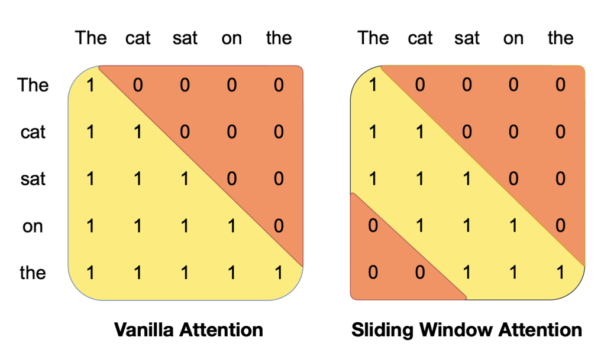
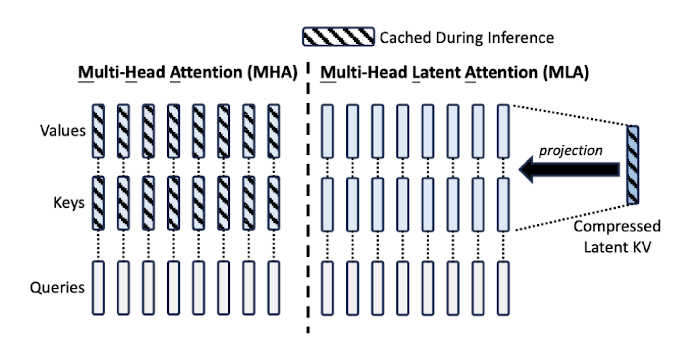
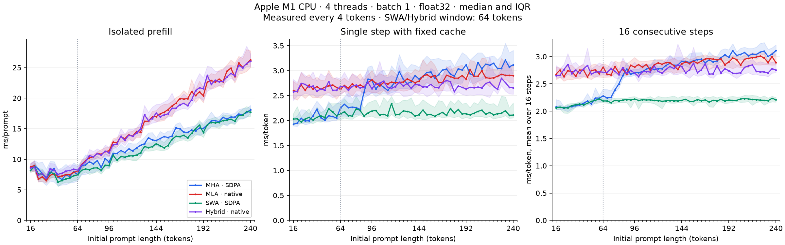
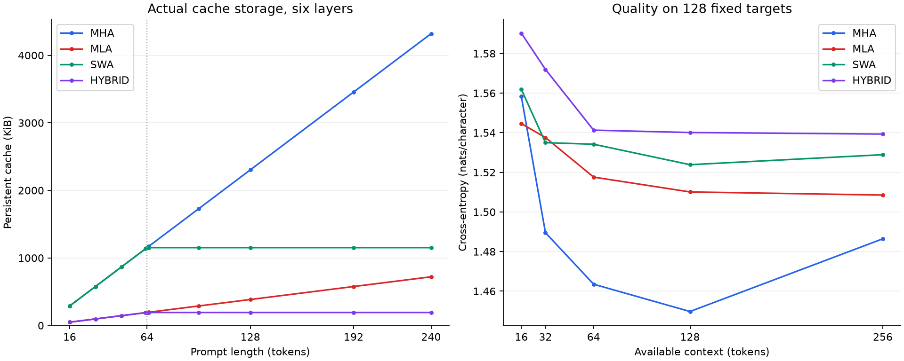

<div align="center">
  <h1>Hybrid Attention</h1>

  <p>
    Combining Sliding Window Attention and Multi-head Latent Attention
    in a decoder-only Transformer.
  </p>

  
  
</div>

## Table of Contents

- [\\operatorname{Attention}(Q,K,V)](#operatornameattentionqkv)
    - [Sliding Window Attention](#sliding-window-attention)
    - [Multi-head Latent Attention](#multi-head-latent-attention)
    - [Hybrid Attention](#hybrid-attention)
  - [Experimental Setup](#experimental-setup)
    - [Model Configuration](#model-configuration)
    - [Hardware](#hardware)
  - [Results](#results)
    - [Language Modeling Performance](#language-modeling-performance)
    - [Inference Performance](#inference-performance)
    - [KV Cache Memory](#kv-cache-memory)
  - [Comment](#comment)
  - [References](#references)
  - [Reproducibility](#reproducibility)

---

## Project Overview

This project explores the implementation and evaluation of a **Hybrid Attention mechanism** that combines two attention strategies:

- **Sliding Window Attention (SWA):** restricts attention to a fixed-size local window, reducing the number of tokens attended to at each step.
- **Multi-head Latent Attention (MLA):** compresses Key and Value representations into a shared latent space, reducing KV cache memory requirements.

The objective is to investigate whether combining these mechanisms can improve memory efficiency while maintaining competitive language modeling performance.

The implementation is based on [nanoGPT](https://github.com/karpathy/nanoGPT), a lightweight decoder-only Transformer.

Four attention architectures are implemented and compared:

| Model | Attention mechanism | Attention context | KV cache |
|---|---|---|---|
| MHA | Standard Multi-Head Attention | Global | Full K/V |
| SWA | Sliding Window Attention | Local | Windowed K/V |
| MLA | Multi-head Latent Attention | Global | Compressed latent |
| Hybrid | MLA + SWA | Local | Windowed compressed latent |

The experimental evaluation focuses on three main aspects:

1. **Language modeling quality:** cross-entropy, perplexity, and bits per character.
2. **Inference performance:** prefill latency, decoding latency, and throughput.
3. **Memory efficiency:** KV cache size and its growth with sequence length.

---

## Architecture

All four models are built on the same nanoGPT-based decoder-only Transformer architecture.

The main architectural difference is the attention mechanism used inside each Transformer block.

### Baseline: Multi-Head Attention

The baseline uses standard causal Multi-Head Attention (MHA), where each token can attend to all previous tokens within the available context.

Given an input sequence of hidden representations, MHA projects them into Query (Q), Key (K), and Value (V) representations.

Attention is computed as:

$$
\operatorname{Attention}(Q,K,V)
=
\operatorname{softmax}\left(
\frac{QK^T}{\sqrt{d_k}} + M
\right)V
$$

where:
- $Q$, $K$, and $V$ are the query, key, and value matrices.
- $d_k$ is the dimension of each attention head's key vectors.
- $M$ is the causal attention mask that prevents attending to future tokens.

During inference, previously computed Keys and Values can be stored in a KV cache to avoid recomputing them at every generation step.

However, the memory required by this cache increases linearly with the sequence length.

### Sliding Window Attention

Sliding Window Attention (SWA) restricts each token to attending only to a fixed number of recent tokens.

Instead of attending to the entire sequence, each token attends to at most $W$ consecutive positions, including itself, where $W$ is the window size.

<center>


*Figure 1. Comparison between standard causal attention and Sliding
Window Attention (SWA). SWA restricts each token to attending only
to a fixed-size window of recent tokens.
Source: [Mistral 7B (Jiang et al., 2023)](https://arxiv.org/abs/2310.06825).*
</center>


**Advantages:**
- Limits the number of attention positions processed per query.
- Bounds the size of the KV cache during decoding.
- Reduces the memory requirements for long sequences.

In this project, SWA uses a window size of **64 tokens**.

### Multi-head Latent Attention

Multi-head Latent Attention (MLA) reduces KV cache memory requirements by compressing Key and Value information into a shared latent representation.

Unlike standard MHA, which stores full Key and Value vectors for each token, MLA computes a compressed representation:

$$
c_t^{KV} = W^{DKV} h_t
$$

where:
- $h_t$ is the hidden representation of token $t$.
- $W^{DKV}$ is a learned down-projection matrix.
- $c_t^{KV}$ is the compressed Key-Value latent vector.

<center>


*Figure 2. Comparison between Multi-Head Attention (MHA) and Multi-head Latent Attention (MLA). MLA reduces KV cache memory requirements by storing compressed latent representations instead of full Key and Value vectors.
Source: [DeepSeek-V2 (DeepSeek-AI et al., 2024)](https://arxiv.org/abs/2405.04434).*
</center>

MLA also uses **decoupled Rotary Position Embeddings (RoPE)**, separating positional information from the compressed Key-Value content.

The implementation uses a KV latent dimension of **96** and a decoupled RoPE dimension of **32**.

### Hybrid Attention

The proposed Hybrid Attention mechanism combines the memory compression of MLA with the local attention constraint of SWA.

The following experiments investigate the practical benefits and computational overhead associated with this combination.

---

## Experimental Setup

All four models were trained on the character-level Shakespeare dataset using a common training configuration.

### Model Configuration

| Parameter | Value |
|---|---|
| Transformer layers | 6 |
| Attention heads | 6 |
| Embedding dimension | 384 |
| Maximum context length | 256 |
| Vocabulary size | 65 |
| SWA window size | 64 |
| MLA KV latent rank | 96 |
| MLA RoPE dimension | 32 |
| Training iterations | 6,000 |
| Training batch size | 16 |
| Optimizer | AdamW |

The models use approximately 10–11 million parameters.

### Hardware

Experiments were conducted on:

- **Device:** Apple M1 (MPS for training; CPU for the inference results below)
- **Memory:** 8 GB unified memory

The inference benchmarks use batch size 1 and cached autoregressive decoding.

---

## Results

The evaluation compares language modeling quality, inference performance, and KV cache memory consumption.

### Language Modeling Performance

Language modeling quality was evaluated on the Shakespeare character-level validation set.

The following table reports cross-entropy (CE), perplexity (PPL), and bits per character (BPC), using the checkpoints selected during training.

| Model | Cross-Entropy ↓ | Perplexity ↓ | BPC ↓ |
|---|---:|---:|---:|
| MHA | **1.4395** | **4.2186** | **2.0768** |
| MLA | 1.4496 | 4.2613 | 2.0913 |
| SWA | 1.4570 | 4.2931 | 2.1020 |
| Hybrid | 1.4587 | 4.3006 | 2.1045 |

All four architectures achieve relatively similar validation performance on this dataset.

MHA achieves the lowest cross-entropy, while the compressed and windowed attention mechanisms introduce small differences in modeling quality.

The final training checkpoints were also evaluated separately. Hybrid achieves a final-checkpoint cross-entropy of **1.4496**, compared with **1.4440** for MHA.

### Inference Performance

Inference performance was evaluated on the Apple M1 CPU using 4 threads, batch size 1, float32, and cached autoregressive decoding with the existing trained checkpoints.

Prompt lengths were measured every **4 tokens**, from 16 to 240 tokens (57 lengths), with 40 timing samples per point across four rounds. The local attention window remains **64 tokens**.

Three measurements were collected:

- **Prefill latency:** time required to process the initial input sequence.
- **Fixed-step latency:** time required for one decoding step with a fixed cache state.
- **Sequential decode latency:** average time per token over 16 consecutive decoding steps.

The following table compares the reference execution paths (SDPA for MHA/SWA, native for MLA/Hybrid) using an initial prompt length of 240 tokens. Values are medians from the [CPU benchmark data](experiments/confronto_cpu_step4_20261018/benchmark.csv).

| Model | Prefill (ms) ↓ | Decode (ms/token) ↓ | Decode throughput (tokens/s) ↑ |
|---|---:|---:|---:|
| MHA | 18.084 | 3.109 | 321.7 |
| MLA | 26.268 | 2.888 | 346.3 |
| SWA | **17.703** | **2.210** | **452.5** |
| Hybrid | 26.056 | 2.755 | 363.0 |

The results reveal that smaller KV caches do not automatically produce faster inference.

In particular:

- SWA has the lowest median prefill and decoding latency at this prompt length.
- Hybrid has a lower median decoding latency than MLA and MHA at this prompt length.
- MHA and SWA have lower median prefill latency than MLA and Hybrid at this prompt length.

The shaded bands show the interquartile range (IQR); overlapping ranges call for caution when interpreting small latency differences.

<center>


*Figure 3. Inference performance of MHA, MLA, SWA, and Hybrid on the Apple M1 CPU (4 threads, batch size 1, float32). From left to right, the panels show prefill latency, single-token latency with a fixed cache, and average latency per token over 16 consecutive decoding steps. Prompt lengths are sampled every 4 tokens from 16 to 240. Lines connect measured medians and shaded bands show the interquartile range. The dotted line marks the 64-token window. At 240 tokens, SWA has the lowest median prefill and decode latency.*
</center>

### KV Cache Memory

One of the main objectives of the Hybrid architecture is to reduce persistent KV cache memory.

The following table reports the KV cache memory for a prompt length of 240 tokens.

| Model | KV Cache (KiB) ↓ | Reduction vs MHA |
|---|---:|---:|
| MHA | 4320 | 1× |
| MLA | 720 | 6× |
| SWA | 1152 | 3.75× |
| Hybrid | **192** | **22.5×** |

Hybrid achieves the smallest KV cache footprint.

Compared with MHA, Hybrid requires **22.5× less KV cache memory** at this sequence length.

This reduction results from combining latent KV compression with a bounded sliding window.



*Figure 5. Left: persistent KV cache storage as prompt length increases. Right: cross-entropy on 128 fixed validation targets as available context grows; lower values indicate better language-modeling quality. The dotted line marks the 64-token attention window. Cache usage for SWA and Hybrid plateaus after the window fills, while MHA storage continues to grow with the prompt.*

These values represent the persistent KV cache only, not the total memory consumption of the model.

---

## Comment

The experiments show that SWA and MLA can substantially reduce KV cache memory while maintaining language modeling quality close to the MHA baseline on the evaluated dataset. Combining the two mechanisms provides the largest memory savings, making Hybrid Attention a promising approach for inference under limited memory budgets.

However, these savings do not automatically translate into faster inference. In the current implementation, MLA and Hybrid have higher prefill latency than MHA and SWA, although both achieve lower median decoding latency than MHA at 240 tokens. This overhead may partly reflect limitations in the implementation and backend optimization.

The main advantages and drawbacks observed in these experiments are:

**Pros**

- **Lower KV cache memory:** combining latent compression and a sliding window reduces cache storage by a factor of 22.5 compared with MHA at 240 tokens.
- **Comparable modeling quality:** validation metrics remain close to the baseline on Shakespeare character-level data.
- **Bounded cache growth:** SWA and Hybrid stop accumulating cached tokens once the attention window is full.

**Cons**

- **Small quality tradeoff:** the alternative architectures achieve slightly worse validation metrics than MHA in the reported comparison.
- **Higher prefill latency:** MLA-based models take longer to process the initial prompt in the current implementation.
- **Implementation-dependent speed:** smaller caches alone do not guarantee lower latency; performance also depends on the execution path and hardware backend.

For larger models and longer contexts, memory savings could become more valuable and potentially offset some computational overhead. Further experiments are needed to establish whether this translates into faster inference.

---

## References

The implementation and evaluation are based on the following works:

1. **nanoGPT** — Andrej Karpathy  
   [GitHub Repository](https://github.com/karpathy/nanoGPT)

2. **DeepSeek-V2: A Strong, Economical, and Efficient Mixture-of-Experts Language Model**  
   Introduces Multi-head Latent Attention (MLA).  
   [Paper](https://arxiv.org/abs/2405.04434)

3. **Mistral 7B**  
   Describes the use of Sliding Window Attention in a decoder-only language model.  
   [Paper](https://arxiv.org/abs/2310.06825)

---

## Reproducibility

Run these commands from the repository root. Benchmarks save their results under `--run` and automatically generate plots in `figure/`. Use a new run directory for each execution.

**Training:** prepare the Shakespeare character-level dataset and train all four architectures.

```bash
python data/shakespeare_char/prepare.py
python train_all.py --dataset shakespeare_char --device mps --max_iters 6000 --sliding_window 64
```

**Language modeling and KV cache:** evaluate cross-entropy, perplexity, bits per character, and cache memory usage.

```bash
python experiments/benchmark_language_modeling.py --run experiments/run_language_modeling --device mps
```

**Inference:** measure prefill latency, cached decoding latency, and throughput on CPU.

```bash
python experiments/benchmark_inference.py --run experiments/run_inference_cpu --device cpu
```

**Generation:** benchmark cached autoregressive generation and evaluate modeling quality at different context lengths.

```bash
python experiments/benchmark_generation.py --run experiments/run_generation --device mps
```